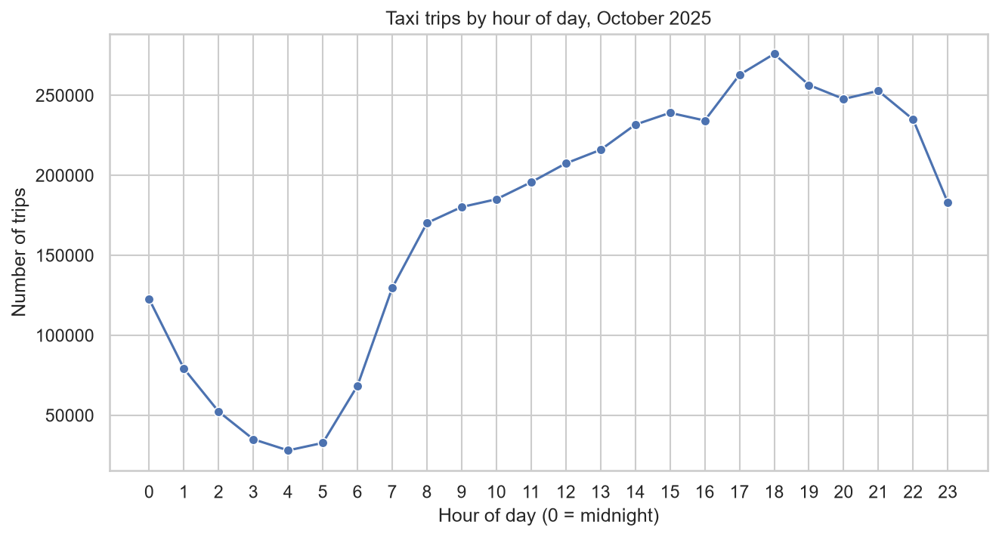
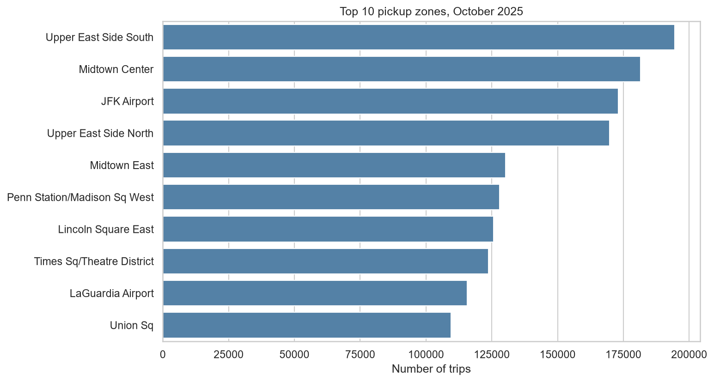

# NYC Taxi Demand Analysis

Exploratory analysis of 4.4 million NYC yellow taxi trips from October 2025. The project asks when and where taxi demand is highest, what a typical trip costs, how much riders tip, and how fast taxis move. About a third of the work is finding and fixing bad records in the data.



## Key findings

- **Demand peaks at 6 pm** with 275,925 trips, about 10 times the quietest hour (4 am, 28,069 trips).
- **Thursday, Friday and Saturday are the busiest days**, at about 142,700 to 144,000 trips per day. Monday is the quietest at 110,665.
- **A typical trip costs about 20 to 22 dollars** in total charge for most of the day. The median is highest at 4 pm (24.06).
- **Card riders tip a median of 26.1% of the fare.** About 8.1% leave no tip.
- **Pickups are concentrated.** The top 10 zones account for about 35% of all trips. Eight are in Manhattan and two are the airports (JFK and LaGuardia).
- **Taxis are slowest in the afternoon**, with a median of 7.4 mph at 3 pm against 16.2 mph at 5 am.



## Data quality work

The raw data has real problems, and the cleaning decisions are documented in the notebook.

- **Impossible records:** negative totals, trips of zero distance, trips under one minute, a trip of 276,333 miles, and timestamps outside the month. I removed 307,087 rows (6.9%).
- **Negative fares need care:** for Flex Fare trips, about 84% of negative-fare rows still have a positive total and a normal distance. I filtered on total_amount instead of fare_amount, which kept these trips.
- **Blank fields:** 22.37% of rows have five blank columns. All of them are Flex Fare trips, so the gaps come from how that trip type is recorded. I kept these rows.
- **Extreme tips:** a maximum tip of 700,000% of the fare appeared in the first pass. I excluded tips above 100% of the fare from the tip analysis (0.13% of card trips) and checked that the median did not change.

## Data

Source: NYC Taxi and Limousine Commission (TLC) trip record data, yellow taxi trips for October 2025, plus the TLC taxi zone lookup table. The data is public and is not stored in this repository. A script downloads it.

## How to run

```powershell
git clone https://github.com/kensimonezike/nyc-taxi-demand-analysis.git
cd nyc-taxi-demand-analysis
python -m venv .venv
.venv\Scripts\activate
pip install -r requirements.txt
python src/download_data.py
jupyter notebook
```

Then open `notebooks/01_nyc_taxi_eda.ipynb` and run all cells. On Mac or Linux, activate with `source .venv/bin/activate`.

## Project structure

```
nyc-taxi-demand-analysis/
├── README.md
├── requirements.txt
├── .gitignore
├── src/
│   └── download_data.py
├── notebooks/
│   └── 01_nyc_taxi_eda.ipynb
└── images/
```

## Limits

- One month of data from one city.
- Cash tips are not recorded, so tip analysis covers card payments only.
- Flex Fare trips have an unreliable fare_amount, so cost analysis uses total_amount.
- Reasons such as traffic are suggested by the data but not proven.

## Tools

Python, pandas, seaborn, matplotlib, Jupyter, PyArrow

## Author

Kensimon Ezike